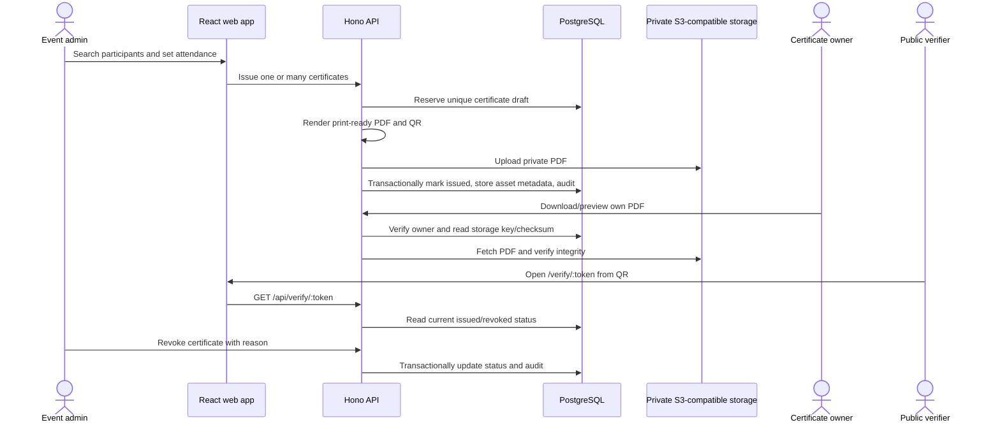

# Certificate Workflow & Lifecycle: HMI Certificate System

## Implemented Lifecycle

## Authorization and Data Rules

- Event admin authorization is scoped to the associated event and checked by
  the API for participant management, issuance, listing, and revocation.
- PDF downloads are authorized through
  `certificates.participant_id → participants.user_id`; admins do not gain
  download rights over another user's certificate.
- One certificate per `(event_id, participant_id)` is enforced by migration
  `0003_certificate_event_recipient_unique.sql` and its PostgreSQL unique index.
- PDFs live in private object storage. PostgreSQL stores the object key,
  MIME type, size, and SHA-256 checksum. The API streams owner-authorized PDF
  bytes and never returns a storage URL.
- Public verification reads current database status and returns only the
  certificate number, title, participant name, event name, issue date, and
  revocation date. A printed PDF is not authoritative proof.
- Issuance uses a database draft, PDF upload, then a transaction for issued
  state, asset metadata, and audit. Failed cleanup is retained as a draft and
  cleanup asset reference for operator follow-up.

## Frontend

Event details show admin-only participant/attendance controls, individual and
bulk issuance, per-recipient results, searchable certificate records, and
revocation controls. `/certificates` lists and searches the current user's
certificates and uses the owner-only PDF endpoint for preview/download.
`/verify/:token` is public and queries the API on each token page load.

## Configuration and Verification

Set `AWS_REGION`, `CERTIFICATE_S3_BUCKET`, and optional
`AWS_ENDPOINT_URL_S3`. Neon Object Storage additionally uses
`AWS_ACCESS_KEY_ID` and `AWS_SECRET_ACCESS_KEY`; custom endpoints use
path-style addressing. Set `CERTIFICATE_PUBLIC_VERIFY_BASE_URL` to the
public web route, such as `https://your-domain/verify`, or omit it to derive
`AUTH_WEB_ORIGIN/verify`. Keep the bucket private.

`apps/api/test/certificates.test.ts` covers in-memory HTTP/service behavior.
`apps/api/test/certificates.database.test.ts` contains a gated PostgreSQL HTTP
integration suite; it requires a disposable migrated database configured with
`TEST_DATABASE_URL` and explicit `TEST_DATABASE_ISOLATED=true`. The configured
development Neon database is not used as a test target.
