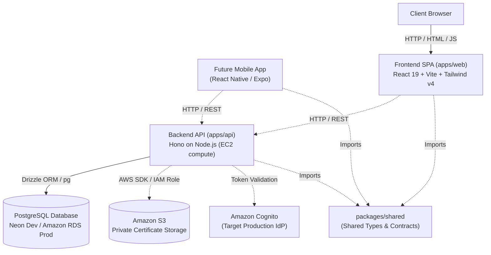

# System Architecture Overview: HMI Certificate System

## 1. System Summary

The **HMI Certificate System** is a Title Certificate Generation and Verification Management System structured as a TypeScript monorepo using `pnpm` workspaces. It consists of:
- `apps/api`: A backend REST API server built with Hono and running on Node.js, providing shared API contracts for both web and future mobile clients.
- `apps/web`: A frontend Single Page Application (SPA) built with React 19, Vite, Tailwind CSS v4, and shadcn/ui.
- `packages/shared`: Shared TypeScript types, schemas, and API contracts.
- **Future Mobile Client**: Planned React Native / Expo application consuming the backend API.
- **Target Deployment**: AWS cloud compute (EC2 or equivalent in a custom VPC) with Amazon RDS for PostgreSQL, Amazon S3 for private certificate storage, Amazon Cognito for production authentication, and CloudFormation for IaC.

---

## 2. Actual Application Components

### A. Backend Application (`apps/api`)
- **Runtime Environment**: Node.js with native ES Modules (`"type": "module"`).
- **HTTP Framework**: [Hono](https://hono.dev/) (`hono@^4.13.13`) with `@hono/node-server` (`^2.1.3`).
- **Entry Point**: `apps/api/src/index.ts`.
- **Target Compute**: EC2 or equivalent cloud compute in a custom VPC.
- **Data Layer Config**: `apps/api/drizzle.config.ts` targets PostgreSQL via Drizzle Kit. Database schema modules are implemented under `apps/api/src/db/schema/` with connection pool in `apps/api/src/db/index.ts`.

### B. Frontend Application (`apps/web`)
- **Runtime & Bundler**: [Vite](https://vite.dev/) (`vite@^8.3.0`) with `@vitejs/plugin-react` (`^6.1.1`).
- **UI Framework**: React 19 (`react@^19.2.8`, `react-dom@^19.2.8`).
- **Styling**: Tailwind CSS v4 (`@tailwindcss/vite@^4.3.3`, `tailwindcss@^4.3.3`) and `tw-animate-css`.
- **Design System & Components**: Shadcn configuration (`components.json`) using the Nova style preset and `@base-ui/react` primitives.
- **Entry Point**: `apps/web/index.html` mounting `apps/web/src/main.tsx`.
- **Certificate UI**: Event admins manage participants, attendance, issuance, certificate search, and revocation. Owners can preview and download PDFs; visitors can verify status at `/verify/:token`.

### C. Shared Package (`packages/shared`)
- **Directory**: `packages/shared`.
- **Purpose**: Workspace package for cross-cutting types, Zod schemas, and API response/error contracts shared across web, mobile, and backend.

---

## 3. Communication Patterns

### Frontend & Mobile to Backend
- **Pattern**: Web client and future React Native / Expo client communicate with the backend over HTTP/REST JSON endpoints using predictable success/error contract envelopes.
- **Current State**: Health, local authentication, event/participant flows, certificate issuance, public verification, private PDF download, and event-admin revocation are implemented. Cognito remains future work. Neon Object Storage has passed an upload/download/delete smoke test; production AWS S3 still requires deployment configuration.

### Certificate issuance and storage

Event admins issue individual or bulk certificates through the Hono API and
manage participants and certificate status in the React UI. Owners can search,
preview, and download their own PDFs; the public verification page queries the
API for the current status.
Drizzle writes certificate state, asset metadata, and audit events; the API
renders print-ready PDFs with verification QR codes and stores them in private
S3 through the AWS SDK v3 adapter. The API checks certificate ownership before
streaming a PDF. Public verification reads current status from PostgreSQL.
Neon Object Storage is supported through the S3-compatible adapter; deployment
must provide a private bucket and storage credentials. AWS S3 workloads should
use the application IAM role.

### Backend to Database
- **Pattern**: Database access uses Drizzle ORM queries and migrations over PostgreSQL (Neon Serverless in development, Amazon RDS in production).
- **Current State**: Connection pool and full relational schemas (users, events, certificates, etc.) are established in `apps/api/src/db/`.

---

## 4. Architectural Boundaries

1. **Frontend Isolation**: The frontend in `apps/web` must not have direct database access or require backend Node.js modules. It interacts strictly via HTTP APIs.
2. **Cross-Platform API Independence**: The backend API contracts must remain independent of browser APIs (`window`, browser cookies, localStorage) to support future React Native / Expo clients.
3. **Backend Domain & Authorization Authority**: The backend API in `apps/api` owns data persistence, business invariants, authorization, and certificate signing/issuance logic. Never trust client-supplied roles or ownership claims.
4. **Identity Provider Decoupling**: Application user profiles and event authorizations use immutable UUID primary keys, cleanly decoupled from external auth providers (Cognito, OAuth).
5. **Private Storage Boundary**: Certificate files are kept private in Amazon S3. Access is authorized by the backend via short-lived presigned URLs or controlled streaming; direct public bucket access is forbidden.
6. **Environment & Secret Protection**: Sensitive credentials (`DATABASE_URL`, AWS secret keys) remain strictly in server environments and must never leak into client bundles.

---

## 5. Verified Source File References

| Component | Responsibility | Verified Path |
| :--- | :--- | :--- |
| Monorepo Config | Workspace packages declaration | `pnpm-workspace.yaml` |
| Root Manifest | Project metadata and package manager definition | `package.json` |
| Backend Entry | HTTP server instantiation and route registration | `apps/api/src/index.ts` |
| Backend Config | Drizzle ORM PostgreSQL configuration | `apps/api/drizzle.config.ts` |
| Frontend HTML | HTML shell mounting `#root` | `apps/web/index.html` |
| Frontend Entry | React DOM root mounting `App` | `apps/web/src/main.tsx` |
| Frontend App | Root UI component (starter counter) | `apps/web/src/App.tsx` |
| Styling Tokens | Global styles, Tailwind v4 imports, theme OKLCH variables | `apps/web/src/index.css` |
| UI Component | Shadcn Button primitive | `apps/web/src/components/ui/button.tsx` |
| UI Utility | Classnames merger (`cn`) | `apps/web/src/lib/utils.ts` |
